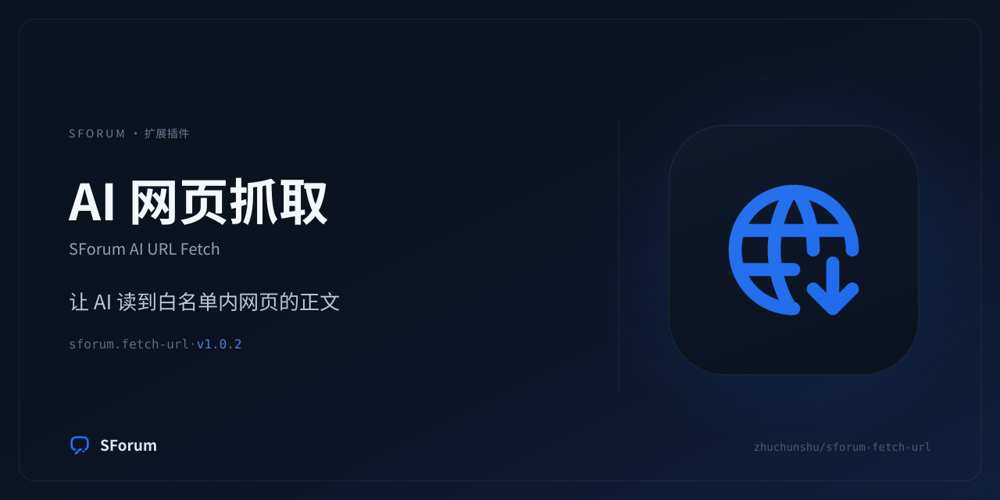

# SForum AI URL Fetch (`sforum.fetch-url`)

[](https://github.com/zhuchunshu/sforum-fetch-url/actions/workflows/ci.yml)
[](https://github.com/zhuchunshu/sforum-fetch-url/releases)



让 SForum 的 AI 回复能够**真的读到**用户给出的外链正文，而不是靠模型记忆猜。

用户在主题或评论里 @ 或回复 AI 机器人并贴出链接时，机器人会调用本插件贡献的
`fetch-url` 工具去抓那一页，再把正文写进回答。

## 它解决什么问题

模型没有联网能力。没有这个工具时，面对「这个链接讲了什么」只有两种结局：
凭训练数据编一个看起来合理的答案，或者如实说自己读不了。前者更糟——它会以
社区机器人的身份发布一个错误事实，并附上一个它从未打开过的链接。

## 三个运营者可调的边界

| 设置 | 作用 |
| --- | --- |
| 总开关 | 关闭后每次调用返回一条可解释的说明，不影响工具在 AI 控制台里的可见性 |
| 域名白名单 | **空 = 拒绝一切抓取**。本插件没有「全部放行」模式 |
| 出站代理 | 支持 `http` / `https` / `socks5`；留空直连 |

白名单匹配只有两条规则，因为写错配置的代价是「静默失效」或「放行了不该放行的站点」：

- `example.com` → 放行 `example.com` 本身，以及它的任意子域（`a.example.com`）；
- `*.example.com` → 只放行子域，不放行 `example.com` 本身。

## 不可配置的安全边界

这些**不进入设置页**，因为工具的调用者不是运营者，而是任意论坛用户——
模型会照着用户给的链接去抓。一个可以被配置关掉的 SSRF 边界等于没有边界。

- 只允许 `http` / `https`（明文 `http` 默认关闭，需显式打开）；
- 禁止 URL 里的 userinfo；
- 拒绝私有/回环/保留地址、单标签主机名、`localhost`、`*.local`、`*.internal`、
  `*.home.arpa` 等内部名字；
- 直连时**解析出的每个 IP 都必须是公网地址**，并且在建立连接时再校验一次
  （防 DNS rebinding）；
- 重定向最多 3 跳，**每一跳都重新过一遍 scheme、主机守卫与白名单**——
  否则一个开放重定向就能把「只允许 example.com」变成「允许任何站点」；
- 只接受文本类响应（`text/*`、JSON、XML）；二进制直接拒绝并说明类型；
- 响应体按上限截断，整段结果不超过宿主 8000 字节的工具结果预算。

### 已知降级：使用代理时不做本机 IP 校验

配置代理后域名由代理解析，插件无法预知真实出口 IP，因此只保留「拒绝字面私有
地址与 `localhost/.local/.internal`」这一层。**请确认代理本身可信。**
这一点同时写在设置页的 callout 里，不是隐藏行为。

## 安装

本插件是**外部扩展包**，不在 SForum 仓库内，也不属于内置插件。

```bash
# 1. 构建二进制 + 刷新摘要 + 宿主校验（需要 SForum 检出在同级目录）
./scripts/prepare-package.sh

# 2. 让 SForum 扫描到本仓库（仓库根就是外部扩展源根）
#    在 SForum 的 .env 里追加（.env 已被 gitignore）
#    EXTERNAL_EXTENSION_ROOTS=...,/abs/path/to/sforum-fetch-url

# 3. 重启 API（外部源只在启动时扫描），然后
#    后台 → 扩展管理 → 插件管理 → 启用（需 super_admin 确认精确制品）

# 4. 让模型能看见这个工具（关键，容易漏）
#    后台 → AI 能力 → AI 用途 → forum.reply → 模型可见工具 → 自定义 → 加入 fetch-url
```

第 4 步不是可选的：**登记 ≠ 暴露**。插件安装后工具会被登记进宿主的工具表，
但模型只看到「用途白名单」里的名字，而插件工具默认不在任何 Core 用途的白名单里。

## 开发闭环

```bash
cd plugins/sforum.fetch-url/backend
go vet ./... && go test ./...

# 改任何包内文件后都必须重跑，宿主以 exact-artifact 校验哈希
cd ../../.. && ./scripts/prepare-package.sh
```

摘要一变，旧的信任授权即失效：后台会显示「升级」，需要重新走一次
「授权当前精确制品 → 确认并升级」。同版本号只改内容时，「重启」按钮不会切换制品。

## 发布

发布走 GitHub Actions（`.github/workflows/release.yml`），本机只需要打标签：

```bash
# 1. 改 plugins/sforum.fetch-url/sforum.extension.json 的 version，并在 CHANGELOG/提交信息里写清变更
# 2. 跑一次准备脚本，确认摘要与宿主契约校验通过
./scripts/prepare-package.sh
# 3. 提交后打标签并推送
git commit -am "feat: v1.0.2 —— …"
git tag -a v1.0.2 -m "v1.0.2" && git push origin main v1.0.2
```

流水线做三件事：

1. **verify**：检出插件仓库与 SForum 框架（`env.SFORUM_REF`，默认钉在宿主 `v3.0.13`——
   `admin.pages[].group` 等扩展宿主面从该版本起已在宿主 main 上，钉 tag 让构建基线可复现）、
   跑 `go vet` / `go test`、校验标签与清单版本一致、构建宿主平台二进制后跑
   `extension digest --write` / `validate` / `test`。
2. **build**：`linux_amd64`、`linux_arm64`、`darwin_arm64`、`darwin_amd64` 分别交叉编译，
   **每个平台各自重写摘要再打包**（跨平台二进制不同，摘要不可混用），产出
   `<slug>_<version>_<os>_<arch>.zip` 与 `.zip.sbom.json`。
3. **publish**：汇总产物、生成 `SHA256SUMS`、创建/更新 Release 并上传；随后断言
   「Release 非草稿 + 四个平台包齐全」，已存在的草稿会被 `--draft=false` 转正，
   缺包或仍是草稿则流水线直接失败。

`workflow_dispatch` 只跑 verify + build，不会动 Release——用来演练构建而不发布。
仓库里提交的摘要是本机 `prepare-package.sh` 的参考值（本机构建用本地 SForum 检出）；
CI 用钉住的宿主 tag 构建，宿主 SDK 与 Go 工具链都和本机未必一致，于是可能算出不同摘要——
这属于预期，CI 只会以 notice 提示，发布包里写入的是 CI 自己算的那一份。

## 两条 AI 工具声明

| 声明 id | 模型可见名 | 用途 |
| --- | --- | --- |
| `sforum.fetch-url.tool.fetch_url` | `fetch-url` | 给模型用 |
| `sforum.fetch-url.tool.probe_fetch` | `sforum-fetch-url-probe` | **只给设置页「测试抓取」按钮用** |

第二条同样被登记进宿主工具表，但永远不会被加入任何用途白名单，因此模型看不到它。
它存在的理由：Core 的 `ai_tool_probe` 设置动作需要一条插件侧的声明作为派发目标，
复用 `aiTools[]` 比新增一套 `probes[]` 声明面小得多。

## 只读静态响应体

本插件不执行 JavaScript，因此只读得到服务端渲染的 HTML。对 SPA 站点会返回空正文
（探测结果里会明说这一点）。这是刻意的：为了读一篇文章而引入无头浏览器，
会把「一个受白名单约束的 HTTP GET」换成「一台可以被任意页面驱动的浏览器」。
